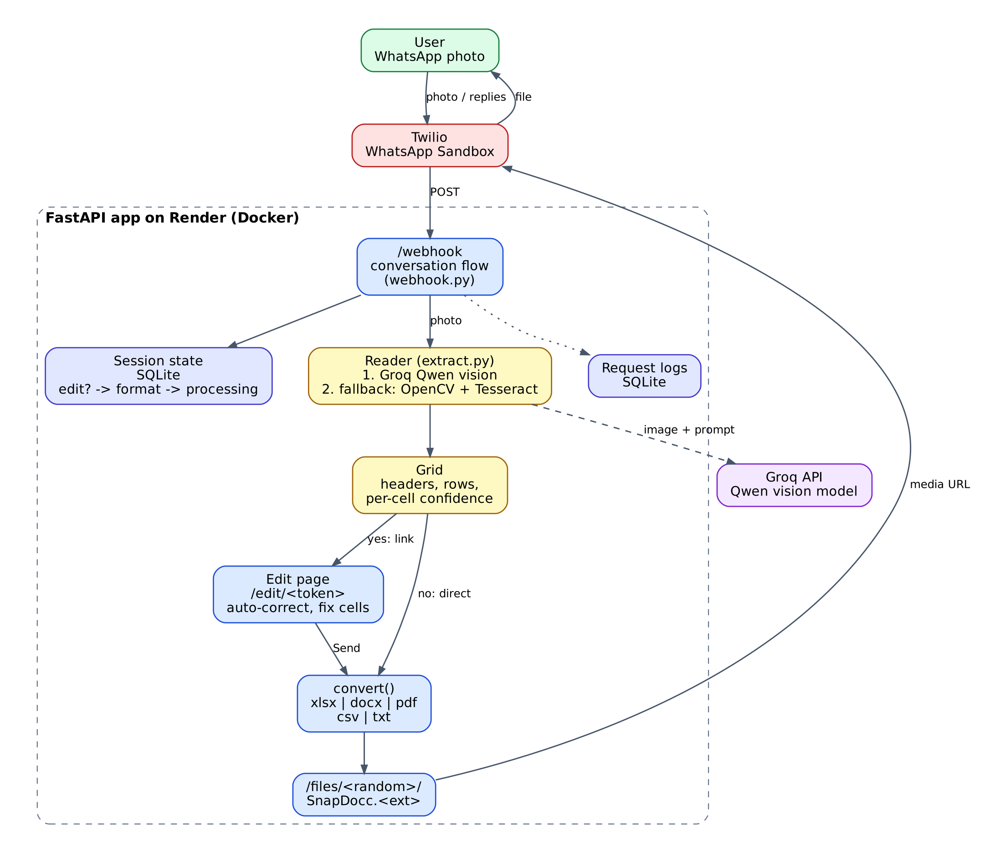

# SnapDocc: WhatsApp Document Digitization Bot

Send a photo (list, table, receipt, note) on WhatsApp, choose a format, get the file back.

## Progress
- [x] Phase 1: OCR core (OpenCV + Tesseract + EasyOCR) and evaluation script
- [x] Phase 2: Structuring (list vs table)
- [x] Phase 3: File generators (Excel, Word, PDF, CSV, TXT)
- [x] Phase 4: WhatsApp webhook, sessions, file delivery
- [x] Phase 5: Logging, Docker, Render deployment
- [x] v2: Groq + Qwen vision OCR (handwriting), web edit page with spelling/grammar auto-correct

## Setup (local development)
1. Python 3.11 (3.10 also works), then `python -m venv venv` and activate it.
2. Install the Tesseract program (pytesseract only wraps it):
   - Windows: installer from the UB-Mannheim build, then set `TESSERACT_CMD` to the full path of `tesseract.exe`
   - Ubuntu: `sudo apt install tesseract-ocr`   |   macOS: `brew install tesseract`
3. `pip install -r requirements.txt` (full dev set - includes EasyOCR for comparison work)
4. Copy `.env.example` to `.env` and fill in your Twilio credentials.

## How it works now (v3)
1. Send a photo on WhatsApp. It is always read on the first go (no "please resend").
2. The bot asks: **edit first?**
   - **1 / yes** -> you get an edit link. Fix cells, click *Auto-correct*, pick a format,
     tap **Send to my WhatsApp** -> the file arrives in the chat (no download needed).
   - **2 / no** -> pick a format (1-5) -> the file arrives straight in WhatsApp.
3. Reading uses **Qwen vision on Groq** (needs `GROQ_API_KEY`), with Tesseract as a fallback.
   If the fallback is used, the bot tells you why (e.g. "AI reading failed (...)").
   Cells the AI is unsure about are highlighted yellow (page and Excel).
4. Replies come from the same Twilio number you chatted with (the webhook's `To` field).

Get a free Groq key at https://console.groq.com -> API Keys, then add to `.env`:
```
GROQ_API_KEY=your_key_here
# Leave GROQ_MODEL unset (the default is qwen/qwen3.8-27b). Remove old qwen3.6 lines.
```
Check that Groq works with your own photo:
```
python -m app.ocr.groq_check path/to/photo.jpg
```
`PUBLIC_BASE_URL` (your ngrok / Render URL) is required for links and files.
The free ngrok URL changes on every restart (update `.env` and the Twilio webhook) and shows
a one-time "Visit Site" warning in the browser - click it.

## Try the OCR/structuring pipeline
```
python -m eval.make_samples                          # creates test images + ground truth
python -m app.ocr.pipeline data/samples/receipt.png   # see both engines' output
python -m eval.evaluate                               # CER / WER comparison table
python -m eval.evaluate --no-preprocess                # does preprocessing help?
pytest                                                 # unit tests
```
For real evaluation, add your own photos to `data/samples/` as `name.jpg` plus `name.txt` (the correct text).

## Run the bot locally
```
uvicorn app.main:app --reload      # in one terminal
ngrok http 8000                    # in another - gives you a public URL
```
Set `PUBLIC_BASE_URL` in `.env` to the ngrok URL, and paste `<ngrok-url>/webhook` into
Twilio Console -> WhatsApp sandbox settings -> "When a message comes in" (method POST).

## View logged requests
Every request (success or failure) is logged to `data/snapdocc.db`:
```
python -m app.db.view_logs         # last 20 requests + summary stats
python -m app.db.view_logs --all   # every request
```

## Deploy with Docker
The production image only includes Tesseract, not EasyOCR - the bot's webhook always
uses Tesseract (`OCR_ENGINE = "tesseract"` in `app/webhook.py`), and EasyOCR pulls in
PyTorch (1GB+), which isn't worth shipping to production. EasyOCR stays available for
local comparison work via `requirements.txt` / `eval/evaluate.py`.

Build and run locally to test the container itself:
```
docker build -t snapdocc .
docker run -p 8000:8000 --env-file .env snapdocc
```

## Deploy to Render (free tier)
1. Push this project to a GitHub repository.
2. Go to https://render.com, sign up, and click **New -> Web Service**.
3. Connect your GitHub repo. Render auto-detects the `Dockerfile`.
4. Under **Environment**, add these variables (same as your local `.env`):
   - `TWILIO_ACCOUNT_SID`
   - `TWILIO_AUTH_TOKEN`
   - `TWILIO_WHATSAPP_NUMBER`
   - `GROQ_API_KEY`
   - `PUBLIC_BASE_URL` - set this to your Render service's URL once it's assigned
     (e.g. `https://snapdocc.onrender.com`), then redeploy.
5. Deploy. Once live, copy the Render URL + `/webhook` into Twilio's
   "When a message comes in" field - **this URL is permanent**, unlike ngrok's,
   so you only set it once.

6. **Keep it awake (important):** the free tier sleeps after ~15 minutes idle and takes
   30-60 s to wake - longer than Twilio's 15 s webhook wait, so the first message after a
   nap would be lost. Create a free monitor at https://uptimerobot.com that requests your
   Render URL (`https://<name>.onrender.com/`) every 5 minutes.

**Known limitation:** Render's free tier uses ephemeral disk, so `data/snapdocc.db`
(the logs) and any generated files reset on redeploy or when the service sleeps from
inactivity. Fine for a capstone demo; a real production setup would use a persistent
disk or an external database.

## Known OCR limitations (honest notes)
- Free OCR engines (Tesseract, EasyOCR) are built for printed text, not cursive
  handwriting - results on handwritten notes will be noticeably worse than on
  printed lists/receipts. This is a genuine limitation of the tools, not the code.
- Low-confidence cells are highlighted in the Excel output so you know what to
  double-check, rather than pretending every result is fully accurate.
- On very worn/faint prints, the OCR engine can fail to detect certain characters
  entirely (not just misread them) - no amount of post-processing can recover text
  the engine never captured in the first place. A clearer, well-lit, straight-on
  photo is the single biggest accuracy lever you have.

## Documentation
- [Project documentation (PDF)](docs/SnapDocc_Documentation.pdf)
- [Presentation (PPTX)](docs/SnapDocc_Presentation.pptx)


